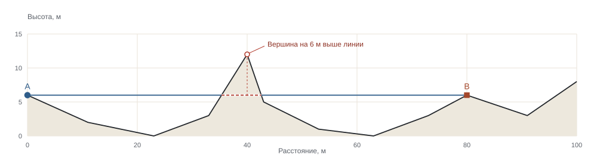

```{=html}
<section class="journal-intro" aria-label="О чём журнал">
  <p class="eyebrow">ГЕОМЕТРИЯ · КАРТЫ · АЛГОРИТМЫ</p>
  <p>От модели и вывода формул — к эксперименту, который можно повторить.</p>
</section>
<section class="issue-feature" aria-labelledby="featured-title">
  <div class="issue-label"><span class="eyebrow">ГЛАВНАЯ СТАТЬЯ · ГЕОМЕТРИЯ ВИДИМОСТИ</span><span class="edition">МАТЕРИАЛ 01</span></div>
  <h1 id="featured-title"><a href="los.html">Почему вершина<br>скрывает цель</a></h1>
  <p class="lede">Две точки на профиле, один гребень между ними. Разбираем точную проверку линии визирования и показываем, как равномерная выборка может пропустить препятствие.</p>
  <div class="feature-meta"><span>УЧЕБНЫЙ ПРОФИЛЬ · PYTHON / NUMPY</span><a class="text-arrow" href="los.html">Читать статью <span aria-hidden="true">→</span></a></div>
  <figure class="cover-profile">
    
    <figcaption><span><strong>Рис. 1.</strong> Вершина перекрывает линию визирования между наблюдателем A и целью B.</span><a href="los.html#experiment">Проверить на графике →</a></figcaption>
  </figure>
</section>
<div class="home-columns">
  <section id="articles" aria-labelledby="articles-title">
    <h2 id="articles-title" class="ruled-heading">Статьи</h2>
    <article class="article-list-item">
      <span class="article-number">01</span>
      <div><p class="eyebrow">ГЕОМЕТРИЯ ВИДИМОСТИ</p><h3><a href="los.html">Почему вершина скрывает цель</a></h3>
      <p>От уравнения луча до доказательства алгоритма. Подробный разбор, псевдокод, оценка сложности и расчёт на Python, который можно запустить в браузере.</p>
      <a class="text-arrow" href="los.html#python">Исходник NumPy <span aria-hidden="true">→</span></a></div>
    </article>
  </section>
  <aside class="home-sidebar">
    <p class="eyebrow">ИНТЕРАКТИВ</p>
    <h2>Лаборатория</h2>
    <p>Меняйте высоты и форму рельефа. Сравнивайте результаты двух методов на одном профиле.</p>
    <svg class="mini-profile" viewBox="0 0 260 44" aria-hidden="true"><path d="M2 35 37 30 66 34 97 21 112 6 127 25 155 34 186 28 212 20 258 25" fill="none" stroke="currentColor" stroke-width="1.4"/><circle cx="2" cy="35" r="3" fill="#2f5d8a"/><rect x="255" y="22" width="6" height="6" fill="#a3472b"/></svg>
    <a class="text-arrow" href="laboratory.html">Открыть эксперимент <span aria-hidden="true">→</span></a>
  </aside>
</div>
<section class="about" id="about" aria-labelledby="about-title">
  <p class="eyebrow">АВТОРСКИЙ НАУЧНО-ПОЗНАВАТЕЛЬНЫЙ ЖУРНАЛ</p><h2 id="about-title">Понять модель.<br>Проверить расчёт.</h2>
  <p>«Тулома» — журнал о математике геопространственных вычислений: геометрии, геодезии, видимости, моделях рельефа и пространственных алгоритмах.</p>
  <p>Разбираем идеи научных работ от постановки задачи и вывода формул до алгоритма и его границ. Интерактивные схемы помогают исследовать модель, а открытый код Python — самостоятельно повторить вычисления.</p>
</section>
```
